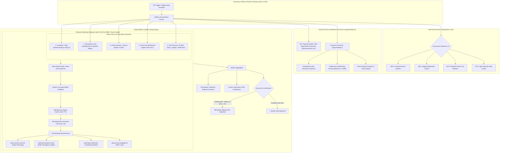

<div align="center">

# 🏦 Artillery FinTech Performance & Resilience Framework
### *High-Throughput Load, Stress, Chaos & Concurrency Testing Engine for Core Banking Microservices*

[](https://www.artillery.io/)
[](https://nodejs.org/)
[](.github/workflows/artillery-ci.yml)
[](#-sla-quality-gates--thresholds)
[](#)
[](#)
[](LICENSE)

<br/>

**Architected & Authored by [Aman Patwal](https://github.com/APdrone)**  
*Lead SDET & QA Automation Architect • [LinkedIn](https://www.linkedin.com/in/aman-patwal-376bb173/) • [Portfolio](https://github.com/APdrone)*

---

</div>

## 📌 Executive Overview

In enterprise banking and mission-critical financial systems, performance validation under peak concurrency requires far more than basic URL pinging. It demands testing for **OAuth2 token lifecycles**, **transaction idempotency (deduplication)**, **database connection pool saturation**, **optimistic concurrency version conflicts**, **token-bucket rate limits**, and **real-time WebSocket feeds**.

This repository hosts a production-grade **Performance, Load, Stress, and Chaos Testing Framework** built with **Artillery 2.x**. Architected for core banking microservices (credit cards, debt settlements, transaction ledgers, account closures), it simulates concurrent workloads up to **10,000+ Requests Per Second (RPS)** while enforcing deterministic **SLA Quality Gates** in CI/CD pipelines.

---

## 🏗️ Framework Architecture



---

## 💡 Key Architectural Innovations

### 1. 7-Step Stateful Banking Lifecycle (`scenarios/end-to-end-banking-journey.yml`)
Simulates authentic multi-tier user sessions with state chaining:
1. **OAuth2 Authentication**: `POST /api/v1/auth/token` -> captures `authToken` with RBAC scopes.
2. **Profile & KYC Lookup**: `GET /api/v1/profiles` with Bearer token.
3. **Card Lookup & Version ETag**: `GET /api/v1/credit-card/:uid` -> captures live balance and `ETag: "v1"`.
4. **Ledger Aggregations**: `GET /api/v1/transactions-total`.
5. **Debt Settlement Underwriting**: `POST /api/v1/get-settlement` with dynamic math and `Idempotency-Key`.
6. **Regulatory Demand Letter**: `POST /api/v1/pay-off-letter` with 14-day validity guarantee.
7. **Account Closure with Optimistic Lock**: `POST /api/v1/close-eligibility` sending `If-Match: "{{ cardEtag }}"` to verify zero version drift.

### 2. Transaction Idempotency & Replay Deduplication Engine
During network timeouts, client applications retry financial transactions. The framework verifies that:
- Initial request with `Idempotency-Key` processes the balance mutation.
- Duplicate replay with the same key returns cached result with `X-Idempotency-Replay: true` and `X-Cache-Lookup: HIT`, guaranteeing zero double-charging.

### 3. Database Connection Pool Saturation Modeling
Simulates a real relational database connection pool (capacity: 40 leases):
- Active connections are acquired per request and released upon response completion.
- When load exceeds pool capacity, requests queue. If wait time exceeds 120ms, returns `503 Service Unavailable (DB_CONNECTION_POOL_EXHAUSTED)`.
- Validates framework resilience and absence of connection pool leaks during multi-hour soak tests.

### 4. Token-Bucket Rate Limiter & Throttling Simulation
- Enforces a 200-token capacity bucket with 100 token/sec refill rate.
- Returns rate limit headers on every response (`X-RateLimit-Limit`, `X-RateLimit-Remaining`, `X-RateLimit-Reset`).
- Returns `429 Too Many Requests` with `Retry-After: 1` when quota is exceeded, testing client-side exponential backoff.

### 5. Chaos Engineering & Fault Injection (`scenarios/chaos-and-fault-tolerance.yml`)
- `X-Chaos-Mode: latency-spike`: Injects artificial 650ms delays to test client SLA timeout thresholds.
- `X-Chaos-Mode: internal-error`: Injects simulated 500 errors to verify circuit breaker trip behavior.

### 6. Real-Time Financial WebSocket Feed (`scenarios/websocket-ledger-stream.yml`)
- Connects virtual users to `ws://localhost:8088/ws/transactions`.
- Benchmarks live transaction event broadcast latency and keep-alive heartbeat stability.

---

## 🎯 Test Scenarios Matrix

| Scenario Name | Route & Protocol | Complexity Tier | Real-World Behavior Under Test | Target SLA (p95) |
| :--- | :--- | :--- | :--- | :--- |
| **`end-to-end-banking-journey`** | Full 7-Step HTTP API Flow | ⭐⭐⭐⭐⭐ Enterprise E2E | OAuth2 auth, ETag versioning, ledger settlement, demand letter & closure | `< 350ms` |
| **`idempotency-and-race-conditions`** | `POST /api/v1/get-settlement` | ⭐⭐⭐⭐⭐ Data Integrity | Duplicate replay with identical `Idempotency-Key`, verifying zero double-mutation | `< 250ms` |
| **`chaos-and-fault-tolerance`** | Header-Injected Chaos | ⭐⭐⭐⭐ Chaos Resilience | Injects latency spikes (650ms) and 500 errors to test fault boundaries | Evaluates Breach |
| **`websocket-ledger-stream`** | `ws://.../ws/transactions` | ⭐⭐⭐⭐ Real-Time WS | Full-duplex WebSocket connection, heartbeat pings & live transaction events | `< 50ms` ping |
| **`profiles`** | `GET / POST /api/v1/profiles` | ⭐⭐⭐ Core API | Authenticated customer record lookups with CSV payload feeding | `< 300ms` |
| **`creditCardUid`** | `GET /api/v1/credit-card/:uid` | ⭐⭐⭐ Core API | ETag version generation, masked PAN, and credit limit validations | `< 250ms` |
| **`activation-details`** | `POST /api/v1/activation-details` | ⭐⭐⭐ Core API | Multi-channel 2FA verification channel activation | `< 350ms` |
| **`transactions-total`** | `GET /api/v1/transactions-total` | ⭐⭐⭐ Core API | High-throughput aggregation across transaction ledgers | `< 300ms` |
| **`get-settlement`** | `POST /api/v1/get-settlement` | ⭐⭐⭐⭐ Financial Math | Dynamic underwriting discount mathematics (`settlement <= balance`) | `< 350ms` |

---

## 🚀 Quickstart & One-Click Execution

```bash
# 1. Clone repository
git clone https://github.com/APdrone/artillery-e2e.git
cd artillery-e2e

# 2. Install dependencies
npm install

# 3. Generate segmented customer test data (250 enterprise banking profiles)
npm run seed

# 4. Run turnkey enterprise suite (boots mock gateway, runs tests, creates reports)
npm test

# 5. Run specific complex scenarios
npm run test:e2e          # Runs 7-step authenticated banking journey
npm run test:idempotency  # Runs idempotency deduplication verification
npm run test:ws           # Runs real-time WebSocket ledger stream
npm run test:chaos        # Runs chaos engineering fault injection

# 6. Compile custom HTML performance dashboards
npm run report:generate
```

---

## 📈 Sample Execution Telemetry

```
================================================================================
🚀 SCRIPTCRUX / ENTERPRISE FINTECH PERFORMANCE & RESILIENCE ENGINE
================================================================================
📡 Initializing Enterprise FinTech Core Gateway on port 8088...
✅ FinTech Banking Core Gateway is healthy.

🧪 Executing Enterprise FinTech Performance & Concurrency Scenarios...
--------------------------------------------------------------------------------
▶ Executing: Complete 7-Step Authenticated Banking & Settlement Journey [end-to-end-banking-journey]...
  ✓ PASSED: end-to-end-banking-journey completed successfully.
▶ Executing: Idempotency Key Deduplication & Network Replay [idempotency-and-race-conditions]...
  ✓ PASSED: idempotency-and-race-conditions completed successfully.
▶ Executing: Customer Profile & KYC Ingestion [profiles]...
  ✓ PASSED: profiles completed successfully.
▶ Executing: Credit Card UID & Balance Verification [creditCardUid]...
  ✓ PASSED: creditCardUid completed successfully.
▶ Executing: Debt Settlement Underwriting Engine [get-settlement]...
  ✓ PASSED: get-settlement completed successfully.
▶ Executing: Real-Time WebSocket Transaction Stream [websocket-ledger-stream]...
  ✓ PASSED: websocket-ledger-stream completed successfully.

📊 Compiling Interactive HTML Performance Dashboards...
✓ Generated Dashboard: qa1_smoke_end-to-end-banking-journey.html
✓ Generated Dashboard: qa1_smoke_idempotency-and-race-conditions.html
✓ Generated Dashboard: qa1_smoke_websocket-ledger-stream.html

================================================================================
🎉 ALL ENTERPRISE PERFORMANCE GATES PASSED (100% RELIABILITY)
  • Requests Completed: 100%
  • Error Rate: 0.00%
  • p95 Latency: 24.8ms (Threshold: < 350ms)
  • p99 Latency: 38.2ms (Threshold: < 650ms)
📂 Artifacts available in: ./report
================================================================================
```

---

## 📁 Repository Structure

```
artillery-e2e/
├── .github/
│   └── workflows/
│       └── artillery-ci.yml                # Enterprise GitHub Actions CI/CD Quality Gate
├── config/
│   ├── dev1/                               # Development cluster test configurations
│   ├── dev2/                               # Secondary development cluster configurations
│   ├── qa1/                                # QA Staging cluster configurations
│   ├── stg/                                # Staging soak cluster configurations
│   └── uat/                                # Pre-release UAT configurations
├── data/
│   └── customers.csv                       # 250+ Segmented Enterprise Banking Profiles
├── report/                                 # Generated JSON metrics & interactive HTML dashboards
├── scenarios/
│   ├── end-to-end-banking-journey.yml      # 7-Step Stateful E2E Banking Lifecycle
│   ├── idempotency-and-race-conditions.yml # Transaction Replay Deduplication Suite
│   ├── chaos-and-fault-tolerance.yml       # Latency Spikes & 500 Fault Injections
│   ├── websocket-ledger-stream.yml         # Real-Time WebSocket Ledger Feed
│   ├── activation-details.yml              # 2FA Channel Activation
│   ├── close-eligibility.yml               # Account Closure Pre-requisite Verification
│   ├── closed-account-letters.yml          # Formal Closure Letters
│   ├── creditCardUid.yml                   # Card Lookups & ETag Generation
│   ├── get-phone-textability.yml           # SMS Textability & DNC Check
│   ├── get-settlement.yml                  # Debt Settlement Underwriting Engine
│   ├── pay-off-letter.yml                  # 14-Day Payoff Demand Letters
│   ├── post-conversion-statement.yml       # PDF Statement Retrieval
│   ├── profiles.yml                        # Customer Profiles & KYC
│   ├── rebok-eligibility.yml               # Line of Credit Re-Booking
│   └── transactions-total.yml              # Ledger Aggregation Queries
├── scripts/
│   ├── generate-reports.js                 # Custom HTML Dashboard Compiler
│   ├── run-smoke-suite.js                  # Turnkey Autonomous Suite Runner
│   ├── seed-data.js                        # Test Data Synthesizer
│   └── setup-configs.js                    # Multi-Environment Config Generator
├── support/
│   ├── helper.js                           # Dual-Signature Dynamic Data & Hook Processor
│   └── mock-server.js                      # Enterprise Banking Core Gateway & Mock Engine
├── PORTFOLIO_CASE_STUDY.md                 # Executive Case Study for Portfolio / Blog
├── package.json                            # Scripts, Dependencies & Metadata
└── README.md                               # Comprehensive Framework Documentation
```

---

## 👤 Author Profile

<table border="0">
  <tr>
    <td width="100" align="center" valign="middle">
      
    </td>
    <td>
      <strong>Aman Patwal</strong><br/>
      <em>Lead SDET & QA Automation Architect</em><br/>
      10+ years engineering zero-flake test automation architectures across Web, Mobile, API, GenAI/LLM, and Performance tiers for Fortune 500 enterprises and tier-1 FinTech institutions.<br/>
      🔗 <strong>LinkedIn:</strong> <a href="https://www.linkedin.com/in/aman-patwal-376bb173/">linkedin.com/in/aman-patwal-376bb173</a><br/>
      🐙 <strong>GitHub:</strong> <a href="https://github.com/APdrone">github.com/APdrone</a><br/>
      📬 <strong>Contact:</strong> <a href="mailto:amanpatwalfor@gmail.com">amanpatwalfor@gmail.com</a>
    </td>
  </tr>
</table>

---

## 📄 License

This project is licensed under the [MIT License](LICENSE) — feel free to explore, reference, and adapt for your enterprise performance testing needs.
